# Project BUCKY — Native-First AWS Architecture

## Purpose

This document defines the recommended AWS target architecture for Project BUCKY.
It keeps BUCKY's FastAPI application, deterministic policy engine, human approval
controls, and worker code in containers while using managed AWS services for
compute, orchestration, persistence, security, AI, observability, and delivery.

The architecture is **native-first, not native-for-its-own-sake**. AWS services
provide durable operational plumbing. They do not replace BUCKY's server-side
rules for identity, risk, approval, separation of duties, verification, audit,
or abstention.

The MVP remains **read-only and simulation-safe**:

- No arbitrary command execution.
- No automatic remediation or service restart.
- No account, Group Policy, production, or ServiceNow write changes.
- Amazon Bedrock provides advice only and cannot approve or execute work.
- Only reviewed, fixed diagnostic operation IDs may collect evidence.

## Recommended architecture

```mermaid
flowchart TB
    Users["Corporate users<br/>BUCKY dashboard"]
    Entra["Microsoft Entra ID<br/>Enterprise identity"]
    ServiceNow["ServiceNow<br/>Read-only ticket API"]
    GitLab["GitLab CI/CD<br/>Build · test · Terraform"]

    subgraph AWS["AWS account — eu-west-1"]
        direction TB

        subgraph Access["Native access controls"]
            R53["Amazon Route 53<br/>Private DNS"]
            ACM["AWS Certificate Manager<br/>TLS certificate"]
            WAF["AWS WAF<br/>Managed rules + rate limits"]
            ALB["Application Load Balancer<br/>Internal HTTPS + OIDC"]
            R53 --> ALB
            ACM --> ALB
            WAF --> ALB
        end

        subgraph VPC["Company VPC — multiple Availability Zones"]
            direction TB

            subgraph Apps["Private application subnets — Amazon ECS on Fargate"]
                API["BUCKY API service<br/>FastAPI + React<br/>2+ tasks"]
                Poller["ServiceNow poller<br/>1 active leader"]
                Worker["Workflow worker<br/>SQS autoscaling"]
                ADOT["ADOT / CloudWatch Agent<br/>Application Signals"]
            end

            subgraph Database["Isolated database subnets"]
                Proxy["Amazon RDS Proxy<br/>Connection pooling"]
                Aurora["Amazon Aurora PostgreSQL<br/>Serverless capacity · Multi-AZ<br/>PITR + encryption"]
                Proxy --> Aurora
            end

            VPCE["AWS PrivateLink / VPC endpoints<br/>ECR · S3 · Logs · Secrets<br/>SQS · Step Functions · Bedrock"]
            Egress["Controlled egress<br/>NAT Gateway / corporate proxy"]
        end

        subgraph Workflow["Native workflow services"]
            SFN["AWS Step Functions Standard<br/>States · callbacks · timeouts"]
            FIFO["Amazon SQS FIFO<br/>Ordering + deduplication"]
            DLQ["Amazon SQS dead-letter queue"]
            Events["Amazon EventBridge<br/>Workflow events"]
            Scheduler["EventBridge Scheduler<br/>Bounded scheduled work"]
            SNS["Amazon SNS<br/>Operational notifications"]
            SFN -->|"approved work"| FIFO
            FIFO -->|"bounded redrive"| DLQ
            SFN --> Events
            DLQ --> SNS
            Scheduler --> SFN
        end

        subgraph AI["Native AI and retrieval"]
            Guardrails["Amazon Bedrock Guardrails<br/>Input/output policy"]
            KB["Amazon Bedrock Knowledge Bases<br/>Managed RAG — optional"]
            Opus["Amazon Bedrock<br/>Claude Opus — advisory only"]
            Vectors["Amazon S3 Vectors<br/>Similarity search — optional"]
            Vectors --> KB
            KB --> Opus
            Guardrails --> Opus
        end

        subgraph Storage["Storage and data protection"]
            Knowledge["Amazon S3<br/>Approved handbooks · sanitized exports<br/>evidence artifacts"]
            Logs["Amazon S3<br/>ALB and archived logs"]
            Secrets["AWS Secrets Manager<br/>DB · Entra · ServiceNow secrets"]
            KMS["AWS KMS<br/>Encryption keys"]
            Backup["AWS Backup<br/>Aurora protection policy"]
            Macie["Amazon Macie<br/>Sensitive-data discovery in S3"]
            KMS -.-> Knowledge
            KMS -.-> Logs
            KMS -.-> Aurora
            Backup --> Aurora
            Macie -.-> Knowledge
        end

        subgraph Delivery["Container delivery and configuration"]
            ECR["Amazon ECR<br/>Immutable container images"]
            Inspector["Amazon Inspector<br/>ECR vulnerability scanning"]
            AppConfig["AWS AppConfig<br/>Validated runtime configuration"]
            Inspector --> ECR
        end

        subgraph Operations["Observability and security posture"]
            CW["Amazon CloudWatch<br/>Logs · metrics · alarms · dashboards"]
            Signals["CloudWatch Application Signals<br/>Service health"]
            XRay["AWS X-Ray / ADOT<br/>Distributed traces"]
            Trail["AWS CloudTrail<br/>Control-plane audit"]
            SecHub["AWS Security Hub<br/>Posture aggregation"]
            GuardDuty["Amazon GuardDuty<br/>Threat findings"]
        end

        IAM["AWS IAM<br/>Separate execution/API/worker/poller roles"]
    end

    Users --> R53
    Users -->|"HTTPS"| ALB
    ALB <-->|"OIDC"| Entra
    ALB --> API

    Poller -->|"HTTPS"| Egress
    Egress -->|"read-only GET"| ServiceNow
    Poller -->|"normalize + deduplicate"| Proxy

    API -->|"tickets · runs · approvals · audit"| Proxy
    Worker -->|"step state · idempotency · verification"| Proxy
    API --> AppConfig
    Poller --> AppConfig
    Worker --> AppConfig

    API -->|"approved evidence"| Knowledge
    Knowledge --> Vectors
    API -->|"redacted context"| Guardrails
    Opus -->|"advisory recommendation"| API

    API -->|"human-approved dispatch"| SFN
    FIFO -->|"long poll"| Worker
    Worker -->|"success · failure · heartbeat"| SFN
    Events --> SNS

    Secrets -.-> API
    Secrets -.-> Poller
    Secrets -.-> Worker
    ECR -.-> API
    ECR -.-> Poller
    ECR -.-> Worker

    API -.-> VPCE
    Poller -.-> VPCE
    Worker -.-> VPCE

    API -.-> ADOT
    Poller -.-> ADOT
    Worker -.-> ADOT
    ADOT --> CW
    ADOT --> Signals
    ADOT --> XRay
    ALB -.-> Logs
    Aurora -.-> CW
    FIFO -.-> CW
    SFN -.-> CW
    Trail -.-> SecHub
    GuardDuty -.-> SecHub

    GitLab -->|"OIDC assume-role"| IAM
    GitLab -->|"push images"| ECR
    GitLab -->|"Terraform deploy"| AWS
    IAM -.-> API
    IAM -.-> Poller
    IAM -.-> Worker

    Human["Human authorization boundary<br/>Entra identity · RBAC · separation of duties<br/>expiring, version-bound approval"]
    API --> Human
    Human -->|"only approved work proceeds"| SFN

    Safety["Read-only MVP boundary<br/>No service restart · no arbitrary command<br/>No automatic remediation"]
    Safety -.-> API
    Safety -.-> Worker
```

## Why ECS Fargate instead of Lambda

BUCKY has three long-lived workload shapes that fit ECS Fargate better than
Lambda:

1. **API service** — a continuously available FastAPI + React application behind
   an internal load balancer.
2. **ServiceNow poller** — persistent read-only polling with a database-backed
   leader lease.
3. **Workflow worker** — long-polls SQS, sends Step Functions callbacks and
   heartbeats, and may hold long-running investigation state.

Fargate preserves the existing container and application model while removing
EC2 host management. Lambda may still be useful for small, stateless glue
handlers, but it should not host BUCKY's core API, poller, or worker.

## ECS workload layout

### API service

- At least two Fargate tasks across multiple Availability Zones in production.
- Internal ALB is the only inbound source.
- `/api/ready` is the load-balancer health endpoint.
- Entra OIDC is enforced; development login is disabled.
- Read-only root filesystem and non-root runtime user.
- Deployment circuit breaker and automatic rollback.
- Autoscaling based on CPU and request load.

### ServiceNow poller service

- Separate Fargate service, rather than a thread in every API replica.
- Desired count starts at one; PostgreSQL leader lease remains the concurrency
  guard during failover.
- Uses a read-only ServiceNow identity.
- Emits last-successful-poll age, new-ticket count, duplicates and failure
  metrics.

### Workflow worker service

- Long-polls the SQS FIFO queue.
- Uses the existing idempotency ledger and stale-claim recovery.
- Reports success, failure and heartbeats to Step Functions.
- Scales from queue backlog while retaining conservative concurrency.
- Starts on On-Demand Fargate; approved workflow execution should not initially
  depend on interruptible capacity.

## Data placement

| Data | AWS system of record |
|---|---|
| Normalized tickets and live inbox | Aurora PostgreSQL |
| Runs, steps, approvals and audit events | Aurora PostgreSQL |
| Idempotency and worker recovery records | Aurora PostgreSQL |
| Approved knowledge metadata and indexes | Aurora PostgreSQL |
| Original handbooks and sanitized exports | Amazon S3 |
| Evidence artifacts and archived logs | Amazon S3 |
| DB, Entra and ServiceNow credentials | AWS Secrets Manager |
| Container images | Amazon ECR |

Aurora remains private and is reached through RDS Proxy. Enable encryption,
automated backup retention, point-in-time recovery and production monitoring.
Use a dedicated migration identity and run schema migrations as a one-off ECS
task before updating the application service.

## AI and evidence flow

1. BUCKY normalizes the selected ticket.
2. The deterministic matcher ranks approved procedures using keywords,
   assignment group, configuration item, error codes and historical evidence.
3. The system abstains when evidence is insufficient.
4. Approved handbooks and sanitized historical material are retrieved from the
   knowledge store.
5. Only the fields needed for the request are sent through Bedrock Guardrails to
   Claude Opus.
6. Opus returns an advisory recommendation with evidence references.
7. BUCKY's deterministic policy engine—not the model—decides what is permitted.
8. A human reviews and authorizes any workflow transition.

## Networking

- Place ECS tasks in private application subnets across at least two
  Availability Zones.
- Place Aurora and RDS Proxy in isolated database subnets.
- Do not assign public IP addresses to tasks or the database.
- Restrict ALB access to approved corporate networks.
- Use security-group references for ALB-to-API and application-to-proxy traffic.
- Use VPC endpoints for supported AWS services.
- Route ServiceNow and Entra traffic through controlled NAT or a corporate
  egress proxy.
- Split API, poller and worker security groups; the worker and poller do not need
  the API's ALB ingress rule.

## Identity, secrets and permissions

Use separate roles for:

- ECS task execution: pull ECR images, publish logs and resolve startup secrets.
- API task: Bedrock advisory calls and SQS dispatch only where required.
- Poller task: minimum access needed for configuration and secrets.
- Worker task: SQS receive/delete and Step Functions callbacks.
- Terraform deployment: assumed by GitLab through OIDC.

Inject Secrets Manager values through the ECS task definition's `secrets`
field. Do not place credentials in images or plain Terraform variables. Scope
`iam:PassRole` to explicit role ARNs.

## Observability

Create CloudWatch dashboards and alarms for:

- ALB target health, HTTP 5xx and p99 latency.
- ECS desired/running task count, CPU, memory and deployment failure.
- SQS depth, oldest-message age and DLQ depth.
- Worker success, failure, replay and reclaimed-claim counts.
- ServiceNow last-successful-poll age and poll errors.
- Aurora connections, capacity, latency and storage.
- Bedrock invocation errors, throttling, latency and usage.

Use CloudWatch Application Signals with ADOT for service health and distributed
tracing. Use CloudTrail for AWS control-plane audit. Security Hub can aggregate
account security posture, while GuardDuty and Inspector provide findings for
their respective coverage areas.

## Deployment flow

1. GitLab runs lint, unit/integration tests and Terraform validation.
2. Build immutable API and worker images tagged with the commit SHA.
3. Scan images in ECR with Inspector.
4. Produce a reviewed Terraform plan.
5. Deploy to development and run smoke tests.
6. Promote the same images to staging.
7. Require manual production approval.
8. Run database migrations as a one-off ECS task.
9. Update ECS services with circuit-breaker rollback enabled.
10. Verify health endpoints, workflow processing and CloudWatch alarms.

Use separate Terraform roots, state, databases, secrets and queues for `dev`,
`staging` and `prod`.

## Current repository versus target

The existing Terraform already provides ECR, ECS Fargate, an internal ALB,
Aurora PostgreSQL, RDS Proxy, SQS FIFO + DLQ, Step Functions, IAM roles, S3 log
storage and CloudWatch Logs. The recommended target extends—not replaces—that
foundation.

Priority gaps to close before production:

1. Inject the authentication secret into the API task definition.
2. Add the dedicated poller service.
3. Raise production API desired count to at least two.
4. Add API and SQS-based worker autoscaling.
5. Split API, worker and poller security groups.
6. Add Aurora backup-retention and production monitoring settings.
7. Add CloudWatch alarms, dashboards and DLQ notifications.
8. Add an S3 knowledge/evidence bucket with KMS, lifecycle and audit controls.
9. Add VPC endpoints and controlled external egress.
10. Add separate staging and production Terraform environments.
11. Wire the API's asynchronous producer to SQS with least-privilege IAM.
12. Keep the read-only MVP boundary explicit until a later remediation phase is
    separately reviewed and approved.

## Cost considerations

The main steady-state costs are expected to be the internal ALB, NAT or egress
path, Aurora minimum capacity and continuously running Fargate tasks. S3 is
unlikely to dominate at this scale, although object requests, KMS operations,
logging, lifecycle transitions and retrieval still contribute. Bedrock cost is
request-driven and should be monitored and bounded. Validate these costs during
the development pilot before fixing production sizing.

## Reference documentation

- [Amazon ECS documentation](https://docs.aws.amazon.com/AmazonECS/latest/developerguide/Welcome.html)
- [Amazon ECS best practices](https://docs.aws.amazon.com/AmazonECS/latest/developerguide/ecs-best-practices.html)
- [Aurora PostgreSQL](https://docs.aws.amazon.com/AmazonRDS/latest/AuroraUserGuide/Aurora.AuroraPostgreSQL.html)
- [Amazon S3 security best practices](https://docs.aws.amazon.com/AmazonS3/latest/userguide/security-best-practices.html)
- [AWS Well-Architected security pillar](https://docs.aws.amazon.com/wellarchitected/latest/security-pillar/)
